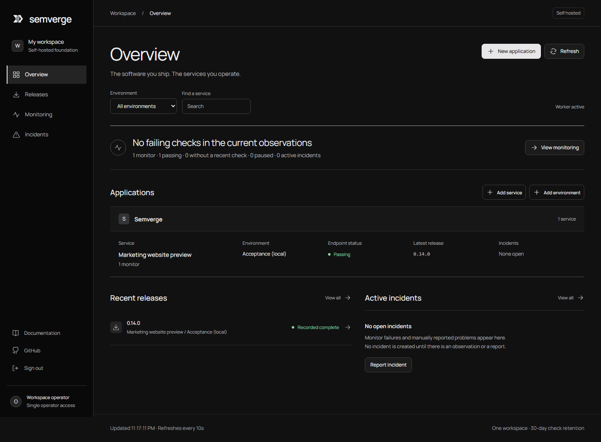
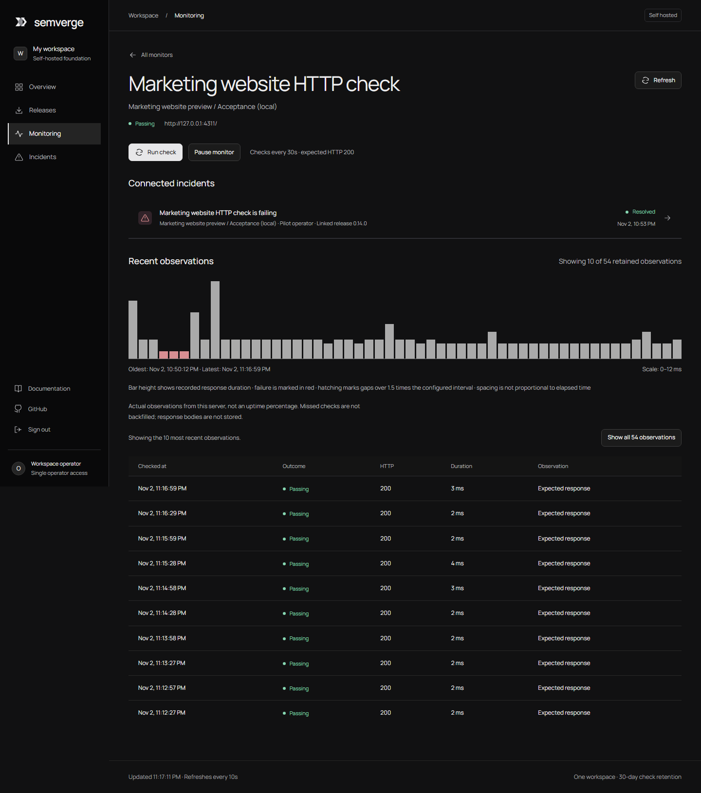
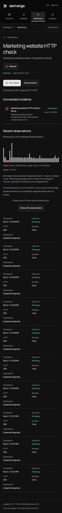
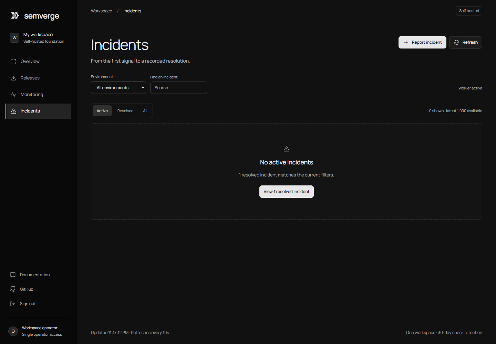
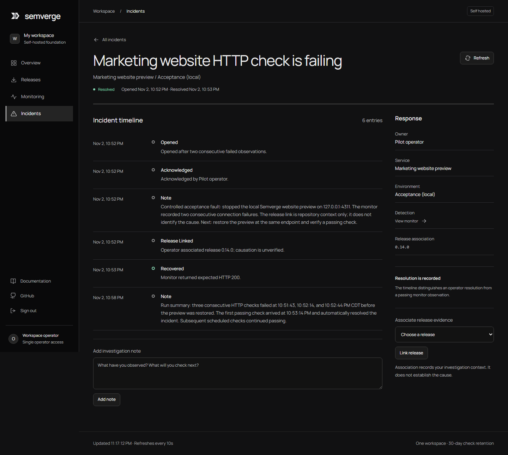
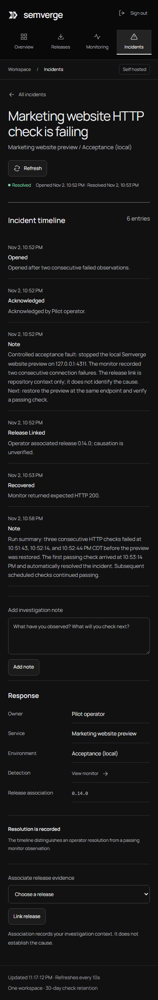
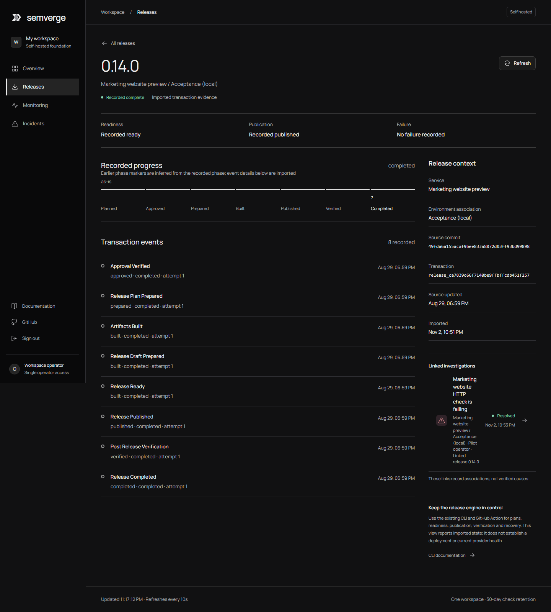
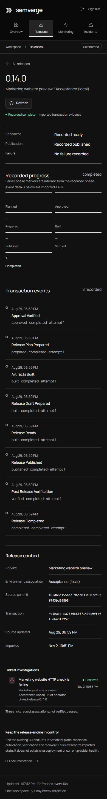

# Operator acceptance pilot

- **Run:** 2 November 2026, America/Chicago
- **Evidence cutoff:** 23:20:08 CDT
- **Verdict:** Conditional go for a controlled, non-production external-user pilot after the existing PR reviews and visual sign-off.

## Environment

- Self-hosted Semverge platform, one operator, one Node process, loopback only.
- Service: a locally built Semverge marketing site served by Vite preview on `127.0.0.1:4311`. This was a real HTTP server and static build, not a mocked response; it was not production or externally reachable.
- Application: `Semverge`.
- Environment: `Acceptance (local)`.
- Monitor: `GET /`, every 30 seconds, expected HTTP 200.
- Release evidence: the release engine's completed `0.14.0` transaction, source commit `49fda6a`. The operator linked it for investigation; the platform correctly recorded that causation was unverified.

The platform and preview were stopped after evidence capture. No production credentials, external services, publishing, release, or deployment actions were used.

## Operator journey

1. Signed in with the local operator token, then created the application, service, environment, and HTTP monitor.
2. Verified three real HTTP 200 observations from 22:50:12 through 22:51:13 CDT.
3. Stopped only the local website preview. Checks failed at 22:51:43, 22:52:14, and 22:52:44. Semverge opened one incident after the second consecutive failure.
4. Acknowledged the incident at 22:52:33, added an investigation note at 22:52:37, and linked release `0.14.0` at 22:52:44 with an explicit no-causation claim.
5. Restarted the preview at the same local endpoint. The first passing HTTP 200 at 22:53:14 recorded recovery and resolved the incident automatically.
6. Inspected the incident timeline, linked release, and monitor history. Restarted the platform against the same SQLite database: records remained intact, the in-memory session had expired, and signing in again restored access.

## Collected evidence

At cutoff, SQLite contained one application, service, environment, monitor, release, and resolved incident; six incident timeline entries; and **60 real observations**: 57 expected HTTP 200 responses and three connection failures. All 60 timestamps were distinct. Successful-check latency was 2–12 ms (median 3 ms). The 30-second scheduler's measured gaps were 30.214 seconds minimum, 30.278 seconds median, and 32.371 seconds maximum; the maximum includes the platform restart. The worker resumed after restart without backfilling missed checks.

The single incident remained open across all three failed checks and resolved on the first passing check. `PRAGMA integrity_check` returned `ok`; `foreign_key_check` returned no violations. The incident, timeline, release association, and observations survived a platform restart.

One resource sample at 23:19:40 CDT showed the platform process at 70.9 MiB working set / 61.9 MiB private memory and the static preview at 78.3 MiB / 101.3 MiB. Combined: 149.2 MiB working set and 163.2 MiB private memory. This is one idle local sample, not a capacity or load test.

## Product review and fixes

The Impeccable OPERATE / Unslop review and two independent critiques found a useful, evidence-centered workspace, with several issues that made it harder to operate:

- A timed refresh could drop keyboard focus. The UI now preserves focus and avoids replacing the page when an interaction overlaps a quiet refresh.
- Active incidents could appear below a long observation table; connected incidents now appear before history, which defaults to the latest ten checks with an expand control.
- The resolved incident row showed its creation time without saying so. It now shows the resolution time with an accessible label.
- An empty active-incident view did not lead to resolved history. It now states that no incidents are active and links to resolved incidents.
- Release phase inference was repeated and its layout overflowed on mobile. The page now explains inference once, keeps imported event details intact, and reflows the phases at mobile widths.
- Browser network failures could be silent or generic. The UI now explains how to recover from server connection loss; the monitor maps common refusal, DNS, timeout, and TLS errors to safe, actionable reasons. The historical outage rows keep the reason emitted by the older process; they were not rewritten.

The overall visual language is clear and restrained. The principal product gap is operational reach: this pilot has no alert delivery or on-call escalation. Compared with the public references, [Better Stack's monitoring setup](https://betterstack.com/docs/uptime/monitoring-start/) includes alerting/escalation paths, [its incident workflow](https://betterstack.com/docs/uptime/working-with-incidents/) supports collaborative incident handling, and [Sentry issue details](https://docs.sentry.io/product/issues/issue-details/) surface stack traces, breadcrumbs, tags, and release context. Semverge's current strength is linking release transactions to genuine HTTP history and operator notes; it is not yet comparable in alerting or diagnostic depth.

## Verification

- `pnpm verify`: typecheck, 36 test files / 303 tests, build, and bundle passed.
- `pnpm platform:test`: 6 tests passed, including refused-connection and DNS-error normalization.
- `pnpm platform:build` and `node --check platform/web/app.js` passed.
- Platform browser smoke: 15 checks passed with zero JavaScript errors, including timed keyboard focus, error feedback, real HTTP failure/recovery, incident workflow, release association, mobile overflow, and sign-out.
- `npm run build` in `website/`: Vite build passed (47 modules).
- Source-checkout CLI `--help`, `recover --help`, and a read-only `plan` command passed. The plan made no provider calls or writes.
- SQLite integrity, foreign keys, unique check timestamps, and the complete incident lifecycle passed as described above.

The automated browser test also simulates its own isolated test service. That data is separate from the 60 observations in this real operator pilot.

## Screenshots

These screenshots were captured from a read-only snapshot of the pilot data and are included in the existing operations-workspace PR for review.

| View | Screenshot |
|---|---|
| Overview, desktop |  |
| Monitor, desktop |  |
| Monitor, mobile |  |
| Empty active incidents |  |
| Incident, desktop |  |
| Incident, mobile |  |
| Release, desktop |  |
| Release, mobile |  |

## Limits and verdict

This pilot establishes the single-process, single-operator HTTP-monitor-to-incident-to-recovery journey. It does not validate sustained uptime, concurrency, multi-host operation, external DNS/TLS, alert delivery, on-call response, or production deployment. Authentication uses the local operator setup and does not validate multi-user roles. A restart requires a new sign-in; missed scheduled checks are not backfilled. Stale monitors become `unknown` after 90 seconds at the tested 30-second interval; paused monitors remain visibly paused.

**Verdict: CONDITIONAL GO** for an initial controlled external-user pilot after required PR reviews and homepage visual approval. The local journey is stable and useful for release-linked HTTP incident response. Broader adoption is held back by the single-operator boundary and the absence of notification/on-call delivery. The highest-value next milestone is a reliable, opt-in incident notification channel with delivery history and safe retry behavior.
